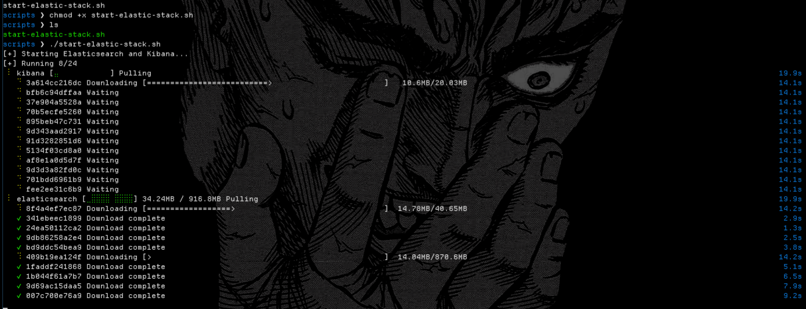

# soc-lab
SOC lab setup, includes whole process of setting up Elasticsearch + Elastic Agent + Kibana on a Windows 11 Virtual Machine

---

```
soc-lab/
│
├── README.md
│
├── docker/
│   ├── docker-compose.yml
│   └── .env.example
│
├── scripts/
│   ├── 01-start-elastic-stack.sh
│   ├── 02-setup-fleet.sh
│   └── 03-health-check.sh
│
├── fleet/
│   └── certificates/
│
├── windows/
│   ├── install-elastic-agent.ps1
│   ├── agent-status.ps1
│   ├── agent-start.ps1
│   ├── agent-stop.ps1
│   └── install-sysmon.ps1
│
└──  detections/
    └── README.md

```

---

# Setup

### docker compose and configure env

- Cloned the repository in my Ubuntu server
- Made sure my tailscale configuration on both the server as well as the firewall allowes access to required ports

```
soc-lab ❯ ls
docker  README.md  scripts
soc-lab ❯ cd docker/
docker ❯ ls -la
-rw-rw-r-- 1 userver userver 1170 Nov 20 23:25 docker-compose.yml
-rw-rw-r-- 1 userver userver    0 Nov 20 23:25 .env.example
```

- I have docker compose which starts elasticsearch and kibana
- Also have a .env.example file which must store passwords

- copy .env.example to .env

```
cd ~/soc-lab/docker

docker ❯ cp .env.example .env
docker ❯ chmod 600 .env
docker ❯ nano .env

docker ❯ ls -la

-rw-rw-r-- 1 userver userver 1170 Nov 20 23:25 docker-compose.yml
-rw------- 1 userver userver  276 Nov 20 23:37 .env
```

- Edit the env file as needed

---

### start elastic stack



```
soc-lab ❯ cd scripts/
scripts ❯ ls
01-start-elastic-stack.sh
scripts ❯ chmod +x 01-start-elastic-stack.sh
scripts ❯ ./01-start-elastic-stack.sh
```
