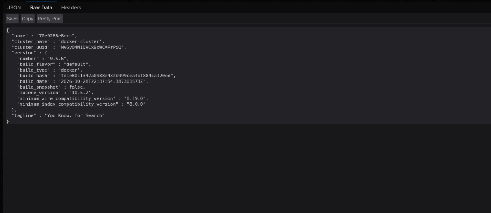
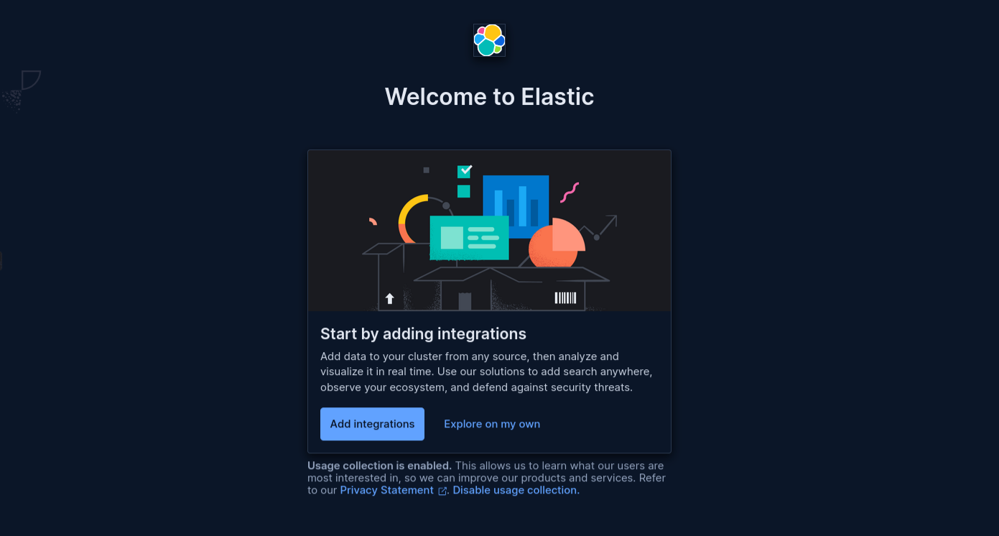

# soc-lab
SOC lab setup, includes whole process of setting up Elasticsearch + Elastic Agent + Kibana on a Windows 11 Virtual Machine

---

```
soc-lab/
│
├── README.md
│
├── docker/
│   ├── docker-compose.yml
│   └── .env.example
│
├── scripts/
│   ├── 01-start-elastic-stack.sh
│   ├── 02-setup-fleet.sh
│   └── 03-health-check.sh
│
├── fleet/
│   └── certificates/
│
├── windows/
│   ├── install-elastic-agent.ps1
│   ├── agent-status.ps1
│   ├── agent-start.ps1
│   ├── agent-stop.ps1
│   └── install-sysmon.ps1
│
└──  detections/
    └── README.md

```

---

# Setup

### Docker Compose and Configure env file

- Cloned the repository in my Ubuntu server
- Made sure my tailscale configuration on both the server as well as the firewall allowes access to required ports

```
soc-lab ❯ ls
docker  README.md  scripts
soc-lab ❯ cd docker/
docker ❯ ls -la
-rw-rw-r-- 1 userver userver 1170 Nov 20 23:25 docker-compose.yml
-rw-rw-r-- 1 userver userver    0 Nov 20 23:25 .env.example
```

- I have docker compose which starts elasticsearch and kibana
- Also have a .env.example file which must store passwords

- copy .env.example to .env

```
cd ~/soc-lab/docker

docker ❯ cp .env.example .env
docker ❯ chmod 600 .env
docker ❯ nano .env

docker ❯ ls -la

-rw-rw-r-- 1 userver userver 1170 Nov 20 23:25 docker-compose.yml
-rw------- 1 userver userver  276 Nov 20 23:37 .env
```

- Edit the env file as needed

---

### Start Elastic Stack


```
soc-lab ❯ cd scripts/
scripts ❯ ls
01-start-elastic-stack.sh
scripts ❯ chmod +x 01-start-elastic-stack.sh
scripts ❯ ./01-start-elastic-stack.sh
```

Once pulled, and if no errors are encountered

```
[+] Running 4/4
 ✔ Network docker_elastic            Created                                                                                                                            0.6s 
 ✔ Volume docker_elasticsearch_data  Created                                                                                                                            0.1s 
 ✔ Container elasticsearch           Started                                                                                                                           10.9s 
 ✔ Container kibana                  Started                                                                                                                            3.5s 

[+] Current container status:
NAME            IMAGE                                                 COMMAND                  SERVICE         CREATED          STATUS         PORTS
elasticsearch   docker.elastic.co/elasticsearch/elasticsearch:9.5.6   "/bin/tini -- /usr/l…"   elasticsearch   12 seconds ago   Up 2 seconds   100.90.48.99:9200->9200/tcp, 9300/tcp
kibana          docker.elastic.co/kibana/kibana:9.5.6                 "/bin/tini -- /usr/l…"   kibana          4 seconds ago    Up 1 second    100.90.48.99:5601->5601/tcp
```
---

### Configure Kibana System Account

```
cd ~/soc-lab/docker

docker ❯ ls
docker-compose.yml
docker ❯ source .env
```

In order to make a new user kibana_system and then reset its password, you must add that user and set new password.

command is: 
`docker exec -it elasticsearch /usr/share/elasticsearch/bin/elasticsearch-reset-password -u [username] -i`
- Here I used kibana_system as my username

```
docker ❯ docker exec -it elasticsearch \
>   /usr/share/elasticsearch/bin/elasticsearch-reset-password \
>   -u kibana_system -i

WARNING: Owner of file [/usr/share/elasticsearch/config/users] used to be [root], but now is [elasticsearch]
WARNING: Owner of file [/usr/share/elasticsearch/config/users_roles] used to be [root], but now is [elasticsearch]
This tool will reset the password of the [kibana_system] user.
You will be prompted to enter the password.
Please confirm that you would like to continue [y/N]y


Enter password for [kibana_system]: 
Re-enter password for [kibana_system]: 
Password for the [kibana_system] user successfully reset.
```

- Replace the newly created kibana password with the one in your .env file

- Visit http://[server-ip]:9200 
- Put in my newly created username and password and I see this



---

### Kibana is now running

At http://[server-ip]:5601 Kibana greets us.
- Logged in using the elastic superuser



- Once I login I add the following integrations
  
  1. System
  2. Windows
  3. Custom Windows Event Logs / Sysmon
  4. Elastic Defend